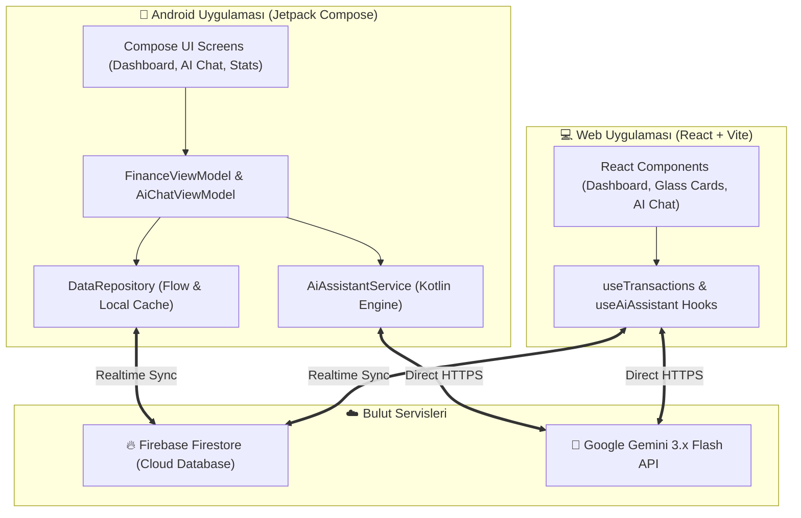

# 💰 Bütçe Takip (Fintech AI Budget Tracker)

<div align="center">


<p align="center">
  <b>Modern, çoklu para birimi destekli, yapay zekâ danışmanlı yeni nesil kişisel finans ve bütçe yönetim platformu.</b><br>
  <i>Native Android (Jetpack Compose) ve Web (React + Vite) platformlarında tam çift yönlü gerçek zamanlı senkronizasyon.</i>
</p>

</div>

---

## 🤖 Yapay Zekâ Destekli Geliştirme (AI-Assisted Development)

> [!NOTE]
> Bu proje, **Süleyman Çağa ([@suleymann-c00](https://github.com/suleymann-c00))** tarafından **Google DeepMind Antigravity** ve **Google Gemini** yapay zekâ modelleri ile **Human + AI Pair Programming (İnsan-Yapay Zekâ Eşli Programlama)** metodolojisi kullanılarak geliştirilmiştir.

### AI Co-Development ile Neler Gerçekleştirildi?
- **Çok Modelli Dayanıklılık Mimarisi (Model Fallback Strategy):** Gemini API'nin rate limit ve yoğunluk durumlarına karşı otomatik model rotasyonu (`gemini-3.6-flash` → `gemini-3.7-flash` → `gemini-3.5-flash-lite`).
- **Doğal Dil Finansal Ayrıştırıcı (NLP Transaction Parser):** Kullanıcının doğal Türkçe konuşmalarından (`"Bugün markete 350 TL harcadım"`, `"2 gr altın yatırımı ekle"`, `"Dünkü 50 liralık kahveyi sil"`) yapılandırılmış işlem verilerini (eylem, kategori, tutar, para birimi, yerel saat dilimine duyarlı tarih) sıfır gecikmeyle ayrıştıran prompt mühendisliği.
- **Toplu Eylem Motoru (Batch Actions):** Yapay zekânın tek bir komutta aynı anda birden fazla ekleme ve silme işlemi yapabilmesini sağlayan dinamik JSON eylem dizisi mimarisi.
- **Sıfır Bağımlılıklı Markdown Motoru:** Web ve Android arayüzlerinde ek ağır kütüphaneler kullanmadan AI yanıtlarındaki formatları (kalın, eğik, listeler) emniyetle ve hafif biçimde görselleştiren Regex tabanlı render sistemi.

---

## 🔐 Güvenlik ve Gizlilik (Security & Privacy by Design)

- **Sıfır Kod İçi Anahtar (Zero Hardcoded Secrets):** Depoda hiçbir Gemini API anahtarı veya gizli anahtar saklanmaz.
- **İstemci Taraflı Güvenli Depolama (Client-Side Storage):** Kullanıcının girdiği Gemini API anahtarı yalnızca cihaz üzerinde yerel olarak saklanır:
  - **Android:** Cihaz içi şifreli `SharedPreferences`
  - **Web:** Tarayıcı içi `localStorage`
- **Doğrudan İletişim:** API istekleri herhangi bir üçüncü taraf aracı sunucuya gitmeden doğrudan Google'ın resmi Gemini API uç noktasına şifreli HTTPS üzerinden iletilir.
- **Firebase İzolasyonu:** Proje konfigürasyonları `.env` ve `google-services.json` ortam dosyalarıyla izole edilmiş, depoya yalnızca şablon (`.example`) dosyalar dahil edilmiştir.

---

## ✨ Temel Özellikler

- 🌐 **Çift Platform (Cross-Platform):**
  - **Android:** Jetpack Compose, Material 3, Clean Architecture, Kotlin Coroutines & StateFlow.
  - **Web:** React 18, Vite, Tailwind CSS, Lucide Icons, Recharts.
- 🪙 **Çoklu Varlık & Para Birimi Desteği:**
  - Türk Lirası (**TRY / TL ₺**)
  - Amerikan Doları (**USD $**)
  - Euro (**EUR €**)
  - Fiziksel Altın (**GOLD gr**)
- 🤖 **Yapay Zekâ Finansal Danışman:**
  - Harcama analizi, bütçe tasarruf tavsiyeleri ve doğal dille harcama/gelir yönetimi.
- 🔄 **Gerçek Zamanlı Çift Yönlü Senkronizasyon:**
  - Firebase Firestore entegrasyonu ile telefonda yapılan işlem anında web ekranına yansır (ve tersi).
  - İnternet kesintilerine karşı çevrimdışı çalışma (offline persistence).
- 📊 **Gelişmiş Finansal Grafikler:**
  - Gelir trendi, gider trendi ve kümülatif varlık değişimi (net servet) zaman çizelgeleri.
- 🎨 **Midas & Revolut Esintili Modern Arayüz:**
  - Glassmorphism cam efektleri, derin gece arka planı ve yüksek kontrastlı neon yeşil/kırmızı aksanlar.

---

## 🏛️ Mimari Şema



---

## 🛠️ Teknoloji Yığını

| Alan | Teknolojiler |
|---|---|
| **Mobil (Android)** | Kotlin 2.0, Jetpack Compose, AndroidX Lifecycle, Kotlin Coroutines, StateFlow, Material 3, Navigation Compose, Firebase Android SDK |
| **Web Frontend** | React 18, Vite, Tailwind CSS, PostCSS, Lucide React, Recharts, Firebase JS SDK |
| **Yapay Zekâ (AI)** | Google Gemini Flash Models (`gemini-3.6-flash`, `gemini-3.7-flash`, `gemini-3.5-flash-lite`), System Instruction, Structured JSON Schema |
| **Bulut & Kimlik** | Google Firebase Authentication, Cloud Firestore (Real-time DB) |

---

## 🚀 Kurulum ve Çalıştırma

### 1. Web Uygulamasını Başlatma

```bash
# Web dizinine geçin
cd web

# Bağımlılıkları yükleyin
npm install

# Ortam değişkenleri dosyasını oluşturun
cp .env.example .env

# Geliştirme sunucusunu başlatın
npm run dev
```

Uygulama `http://localhost:5173` (veya `http://localhost:3000`) adresinde çalışacaktır.

---

### 2. Android Uygulamasını Başlatma

1. Projeyi **Android Studio** (Ladybug veya daha yeni sürüm) ile açın.
2. `app/google-services.json.example` dosyasını `app/google-services.json` olarak kopyalayıp kendi Firebase projenizin değerlerini girin.
3. Gradle senkronizasyonunu tamamlayın.
4. Terminalden doğrudan derlemek veya emülatörde çalıştırmak için:

```bash
# Debug APK derleme
./gradlew assembleDebug

# Cihaza veya emülatöre yükleme
./gradlew installDebug
```

---

### 3. Yapay Zekâ Asistanını Aktifleştirme

1. [Google AI Studio](https://aistudio.google.com/app/apikey) adresinden ücretsiz bir **Gemini API Anahtarı** alın.
2. Web veya Android uygulamasında **Ayarlar ➔ Yapay Zeka (AI)** menüsüne gidin.
3. API anahtarınızı yapıştırıp **Kaydet** butonuna basın.
4. Ana ekrandaki **AI** butonuna dokunarak asistanınızla sohbete başlayabilirsiniz!

---

## 📄 Lisans

Bu proje [MIT Lisansı](LICENSE) kapsamında açık kaynak olarak lisanslanmıştır.

---

<div align="center">
  Geliştirici: <b>Süleyman Çağa</b> (<a href="https://github.com/suleymann-c00">@suleymann-c00</a>)<br>
  <i>Google DeepMind Antigravity & Gemini iş birliğiyle üretilmiştir.</i>
</div>
